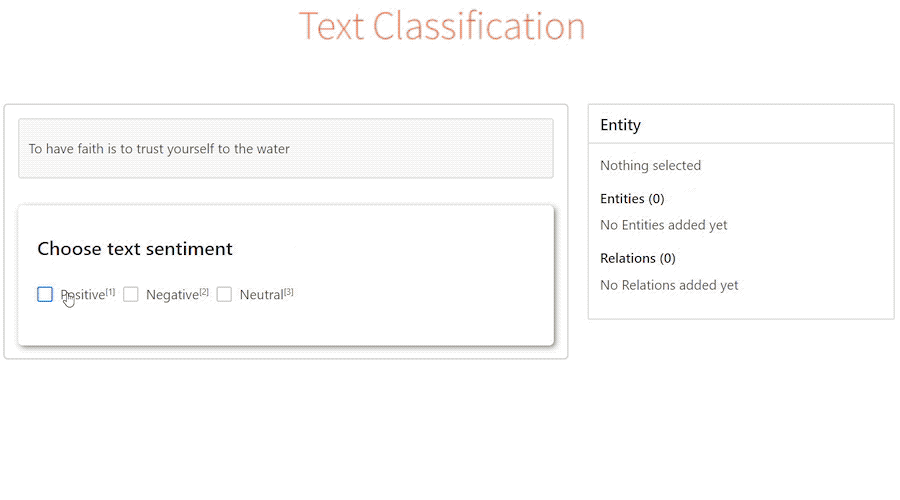
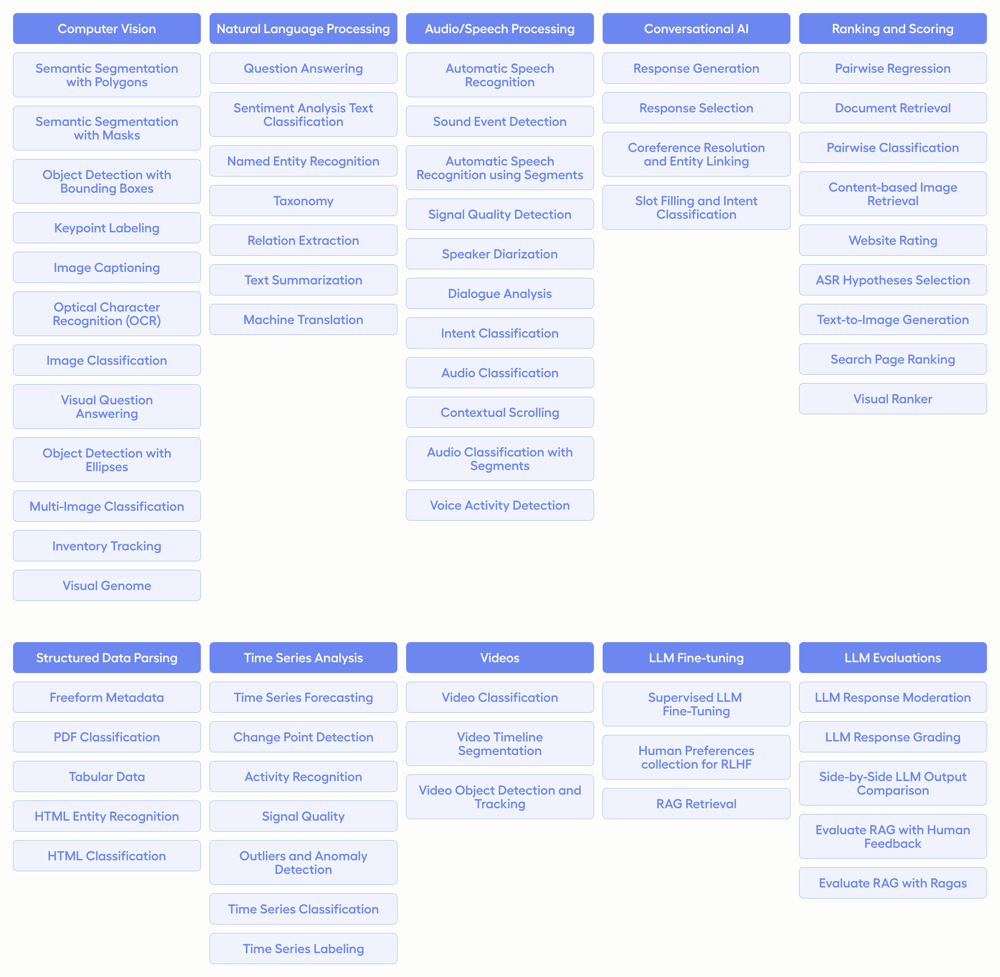

# Label Studio 中文文档

[English README](../README.md)

Label Studio 是一款开源数据标注工具，支持音频、文本、图像、视频和时间序列等多种数据类型。它提供直观的标注界面，并支持导出为多种机器学习模型所需的格式，可用于准备原始数据或持续改进训练数据。

- [本分支的项目级访问控制](#本分支的项目级访问控制)
- [快速开始](#快速开始)
- [主要功能](#主要功能)
- [标注模板](#标注模板)
- [连接机器学习模型](#连接机器学习模型)
- [生态系统](#生态系统)



## 本分支的项目级访问控制

本分支增加了显式的项目成员关系，并提供两种项目级角色：

- **管理员（Admin）**：可以管理项目及项目成员，查看项目中的全部标注和 Data Manager 视图，并执行导入、导出、存储配置、Webhook 和机器学习集成等项目级操作。
- **标注员（Annotator）**：只能进入已分配的项目，并且只能查看自己的标注、草稿和 Data Manager 视图。项目管理及项目级操作会在界面中隐藏，同时由服务端拒绝未授权请求。

创建项目的用户会自动成为已启用的项目管理员。管理员可以通过 **Project Settings > Members** 管理成员，包括：

- 搜索组织内现有且处于启用状态的账号；
- 一次添加多个项目成员；
- 分配或修改管理员、标注员角色；
- 从项目中移除成员。

组织用户不会自动获得所有项目的访问权限。用户必须具有已启用的项目成员关系才能访问对应项目。当前成员添加流程仅支持组织内已有账号，不包含通过邮箱邀请未注册用户的流程。

更完整的实现状态、安全策略和验证记录请参阅[项目访问控制进度](project-access-control-progress.md)。

## 快速开始

### 使用本分支 Docker 镜像

拉取本分支镜像并在 `http://localhost:28000` 访问 Label Studio：

```bash
docker pull docker.io/mars160/label-studio:latest
docker run -it \
  -p 28000:8080 \
  -v "$(pwd)/mydata:/label-studio/data" \
  docker.io/mars160/label-studio:latest
```

SQLite 数据库和上传文件会保存在当前目录的 `mydata` 文件夹中。

如需覆盖默认启动命令，可以在镜像名后追加参数：

```bash
docker run -it \
  -p 28000:8080 \
  -v "$(pwd)/mydata:/label-studio/data" \
  docker.io/mars160/label-studio:latest \
  label-studio --log-level DEBUG
```

### 构建本分支镜像

本分支的 Dockerfile 支持并行编译，并支持为中国大陆网络环境配置 Alpine、Yarn 和 PyPI 镜像：

```bash
docker build \
  --build-arg BUILD_JOBS="$(nproc)" \
  --build-arg ALPINE_REPOSITORY=https://mirrors.aliyun.com/alpine \
  --build-arg YARN_REGISTRY=https://registry.npmmirror.com \
  --build-arg PIP_INDEX_URL=https://mirrors.ustc.edu.cn/pypi/simple \
  -t docker.io/mars160/label-studio:latest .
```

`BUILD_JOBS` 应设置为构建机器可用的 CPU 核心数，省略时默认为 `1`。如果系统没有 `nproc` 命令，请直接填写可用核心数。

### 使用 Docker Compose

仓库中的 Compose 配置会启动以下服务：

- Label Studio；
- Nginx；
- PostgreSQL。

启动服务：

```bash
docker compose up
```

默认配置使用 `docker.io/mars160/label-studio:latest`，访问地址为 `http://localhost:28000`。如需运行当前检出的代码，请先按照上一节构建本地镜像。

如需同时启动 MinIO 作为本地 S3 存储：

```bash
docker compose -f docker-compose.yml -f docker-compose.minio.yml up -d
```

详细存储配置请参阅[数据存储指南](source/guide/storedata.md)。

### 使用 pip 安装

需要 Python 3.10 或更高版本：

```bash
pip install label-studio
label-studio
```

启动后访问 `http://localhost:8080`。

### 使用 Poetry 安装

```bash
pip install poetry
poetry new my-label-studio
cd my-label-studio
poetry add label-studio
poetry shell
label-studio
```

### 本地开发

当前仓库使用 Poetry 管理后端依赖，使用 Yarn 管理前端依赖。

后端开发环境：

```bash
poetry install --with test
make migrate-dev
make run-dev
```

前端开发环境：

```bash
make frontend-install
make frontend-dev
```

前端热更新的更多说明请参阅[前端开发文档](../web/README.md)。

## 主要功能

- **多用户标注**：用户可以注册和登录，标注结果会关联到具体账号。
- **多项目管理**：可在同一实例中管理多个数据集和标注项目。
- **项目级成员与角色**：本分支通过管理员和标注员角色隔离项目、标注和 Data Manager 数据。
- **可配置标注界面**：使用 Label Studio 配置语言组合符合业务需求的标注界面。
- **多数据类型支持**：支持图像、音频、文本、HTML、时间序列和视频等数据。
- **灵活的数据导入**：支持文件上传、Amazon S3、Google Cloud Storage，以及 JSON、CSV、TSV、RAR 和 ZIP 等格式。
- **机器学习集成**：支持展示和比较模型预测、预标注以及主动学习流程。
- **REST API**：可将 Label Studio 集成到现有数据处理和机器学习流水线中。

## 标注模板

Label Studio 内置多种常用标注模板，也可以使用配置语言创建自定义模板。



## 连接机器学习模型

可以通过 Label Studio Machine Learning SDK 连接自定义模型：

1. 启动机器学习后端服务，具体步骤参阅 [Label Studio ML Backend](https://github.com/HumanSignal/label-studio-ml-backend)。
2. 在项目设置的模型页面中连接该服务。

连接后可以执行以下操作：

- 使用模型预测进行预标注；
- 随着新标注产生进行在线学习和重新训练；
- 通过主动学习优先选择更复杂的数据进行标注。

## 生态系统

| 项目 | 说明 |
| --- | --- |
| Label Studio | 服务端应用，以 Python 包和 Docker 镜像形式发布 |
| [Editor 前端库](../web/libs/editor/) | 基于 React 和 mobx-state-tree 的标注编辑器 |
| [Data Manager 前端库](../web/libs/datamanager/) | 用于浏览、筛选和管理项目数据的前端库 |
| [label-studio-converter](https://github.com/HumanSignal/label-studio-sdk/tree/master/src/label_studio_sdk/converter) | 将标注结果转换为常见机器学习格式 |
| [label-studio-transformers](https://github.com/HumanSignal/label-studio-transformers) | 与 Label Studio 集成的 Transformers 工具 |

## 许可证

本项目基于 [Apache 2.0 许可证](../LICENSE)发布。
